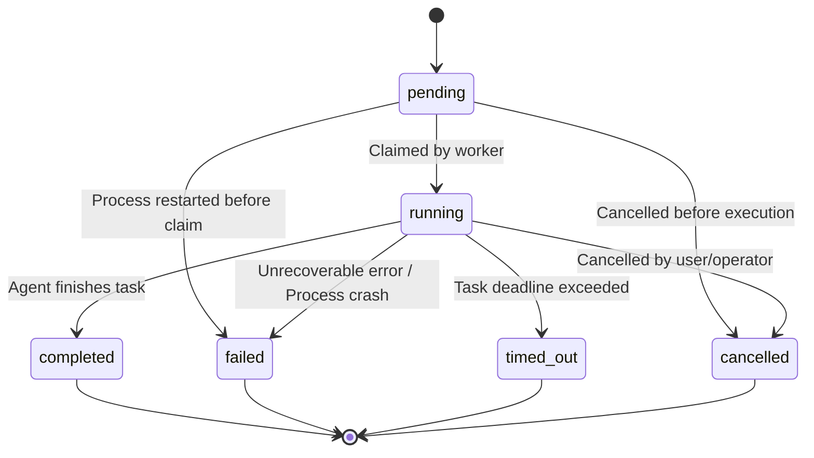

# AI Sandbox — Phase 6 Backend Integration Handoff Document

This document provides the definitive integration contract, API specifications, lifecycle semantics, and architectural guidance for frontend engineers integrating with the AI Sandbox backend.

---

## 1. System Overview & Architecture

AI Sandbox is an ephemeral, secure execution platform designed for autonomous AI agents. The backend is a FastAPI modular monolith with PostgreSQL persistence and dual execution backends (Docker containers and QEMU ARM64 Linux VMs using Apple Silicon HVF acceleration).

```
+-----------------------------------------------------------------------------------+
|                                  BROWSER CLIENT                                   |
|                          (User Authentication & Session)                          |
+-----------------------------------------+-----------------------------------------+
                                          |
                                          | Browser Session / Cookie / Auth Token
                                          v
+-----------------------------------------------------------------------------------+
|                 BACKEND-FOR-FRONTEND (BFF) / API PROXY (Next.js / Node)           |
|  * Validates user identity & session                                              |
|  * Protects backend credentials (stores SANDBOX_API_KEY server-side)              |
|  * Validates & sanitizes incoming parameters                                      |
|  * Translates client requests to FastAPI backend calls                            |
+-----------------------------------------+-----------------------------------------+
                                          |
                                          | HTTP with X-API-Key: <SANDBOX_API_KEY>
                                          v
+-----------------------------------------------------------------------------------+
|                              AI SANDBOX FASTAPI BACKEND                           |
|  * Session Lifecycle & State Engine      * Security Policy Confinement            |
|  * Persistent Workspace Management       * Agent Orchestrator & Recovery Loop     |
+-------------------+---------------------------------------+-----------------------+
                    |                                       |
                    v                                       v
+------------------------------------+    +-----------------------------------------+
|       POSTGRESQL PERSISTENCE       |    |           EXECUTION BACKENDS            |
|  * sandboxes (Logical Sessions)    |    |  * Docker: Ephemeral hardened container |
|  * execution_jobs (Run History)    |    |  * QEMU: Ephemeral ARM64 Linux VM (HVF) |
|  * agent_tasks (Multi-Turn State)  |    |  * Persistent host-managed workspaces   |
+------------------------------------+    +-----------------------------------------+
```

### Core Architectural Distinctions
* **Logical Sandbox Session** (`sandboxes` table): A long-lived logical session with a Time-To-Live (TTL). Owns a dedicated host-managed workspace and tracks execution history.
* **Persistent Workspace**: A filesystem directory allocated per logical sandbox. Files written before or during executions persist across execution runs unless explicitly deleted.
* **Execution Environment** (`execution_jobs` table): A fresh, isolated, ephemeral container or VM created for each run. It mounts the sandbox workspace, executes code, synchronizes modified files back to the persistent workspace, and is immediately destroyed.
* **Agent Task** (`agent_tasks` table): An autonomous multi-turn reasoning and tool-calling execution bound to an active sandbox session. The agent inspects files, creates code, executes it inside fresh containers, analyzes tracebacks, and iterates to a final result.

---

## 2. Developer Setup & Local Environment

Follow these verified steps to run the backend and database locally.

### Prerequisites
* Python 3.12+
* Docker Desktop or Docker Engine running with socket access (`/var/run/docker.sock`)
* PostgreSQL 16 (via Docker Compose)

### Setup Commands

```bash
# 1. Clone and navigate to repository
cd ai-sandbox

# 2. Create and activate virtual environment
python3 -m venv venv
source venv/bin/activate

# 3. Install backend and development dependencies
pip install -e ".[dev]"

# 4. Configure local environment variables
cp .env.example .env
# Edit .env: set SANDBOX_POSTGRES_PASSWORD and SANDBOX_DATABASE_URL
```

### Start Database & Apply Migrations

```bash
# Start local PostgreSQL service on port 5433
docker compose up -d db

# Run Alembic database migrations
alembic upgrade head
```

### Run the Backend Server

```bash
uvicorn app.main:app --reload --host 127.0.0.1 --port 8000
```

### Interactive API Documentation
* **Swagger UI (OpenAPI Interactive)**: [http://127.0.0.1:8000/docs](http://127.0.0.1:8000/docs)
* **ReDoc**: [http://127.0.0.1:8000/redoc](http://127.0.0.1:8000/redoc)
* **Raw OpenAPI Specification**: Exported at `docs/openapi.json` and [http://127.0.0.1:8000/openapi.json](http://127.0.0.1:8000/openapi.json)

### Run Automated Tests

```bash
# Run isolated test suite (PostgreSQL test database on port 5439)
./scripts/run_isolated_tests.sh
```

---

## 3. Authentication & Backend-For-Frontend (BFF) Architecture

> [!CAUTION]
> **Zero Browser Credential Exposure**: Never expose `SANDBOX_API_KEY` to the browser under variables like `NEXT_PUBLIC_API_KEY` or `VITE_API_KEY`. Any client-side key exposure allows arbitrary clients to create containers, run code, and exhaust server resources.

### Mandatory Architecture: Server-Side BFF / API Proxy

All browser interactions must pass through an intermediary backend layer (e.g. Next.js App Router API routes, Remix loaders/actions, or Express/Fastify gateway):

```
React Browser  --->  Authenticated BFF / API Proxy  --->  FastAPI Backend
(User Session)       (Server-Side SANDBOX_API_KEY)         (X-API-Key Header)
```

### Security Rules for the BFF
1. **User Authentication**: The browser authenticates to the BFF using standard session cookies, JWTs, or OAuth tokens (e.g., NextAuth, Auth0, Clerk).
2. **Server-Side Secret Injection**: The BFF securely stores `SANDBOX_API_KEY` in private server environment variables and injects the header `X-API-Key: <SANDBOX_API_KEY>` when making requests to the FastAPI backend.
3. **Restricted Proxying**: The BFF must **not** act as an open reverse proxy. It must validate inputs, enforce permissions, and route only allowable operations to the sandbox backend.
4. **Multi-Tenancy Notice**: Storing a single backend API key in the BFF authenticates the BFF service to the FastAPI backend. It **does not** provide per-user data isolation on the backend. The BFF must manage user ownership of sandbox IDs until native multi-tenant authorization is introduced.

### Backend Header Specification
All endpoints under the `/api/v1` prefix enforce API key authentication in `staging` and `production` environments:

```http
X-API-Key: <SANDBOX_API_KEY>
```

* **`development` / `test`**: Optional if `SANDBOX_API_KEY` is empty. If configured in `.env`, the header must match.
* **`staging` / `production`**: Strictly mandatory. Requests missing or providing an invalid `X-API-Key` receive `401 Unauthorized`.
* **Probes**: `/health` and `/ready` are public infrastructure endpoints and never require authentication.

### Unauthorized Response (401)
```http
HTTP/1.1 401 Unauthorized
WWW-Authenticate: ApiKey
Content-Type: application/json

{
  "detail": "A valid X-API-Key is required."
}
```

### Production Next.js App Router BFF Implementation Example

```typescript
// app/api/sandboxes/[sandboxId]/agent/tasks/route.ts
import { NextRequest, NextResponse } from 'next/server';
import { getServerSession } from 'next-auth'; // Or your auth framework

const BACKEND_URL = process.env.SANDBOX_BACKEND_URL || 'http://127.0.0.1:8000';
const BACKEND_API_KEY = process.env.SANDBOX_API_KEY;

export async function POST(
  req: NextRequest,
  { params }: { params: { sandboxId: string } }
) {
  // 1. Authenticate user session
  const session = await getServerSession();
  if (!session || !session.user) {
    return NextResponse.json({ error: 'Unauthorized', message: 'User session required' }, { status: 401 });
  }

  // 2. Validate input payload
  let body: unknown;
  try {
    body = await req.json();
  } catch {
    return NextResponse.json({ error: 'BadRequest', message: 'Invalid JSON payload' }, { status: 400 });
  }

  const { sandboxId } = params;
  if (!sandboxId) {
    return NextResponse.json({ error: 'BadRequest', message: 'Sandbox ID is required' }, { status: 400 });
  }

  // 3. Forward request with server-side X-API-Key
  try {
    const backendRes = await fetch(`${BACKEND_URL}/api/v1/sandboxes/${sandboxId}/agent/tasks`, {
      method: 'POST',
      headers: {
        'Content-Type': 'application/json',
        ...(BACKEND_API_KEY ? { 'X-API-Key': BACKEND_API_KEY } : {}),
      },
      body: JSON.stringify(body),
      // Set upstream timeout accommodation (task execution is synchronous)
      signal: AbortSignal.timeout(150_000), // 150 seconds
    });

    const data = await backendRes.json();
    return NextResponse.json(data, { status: backendRes.status });
  } catch (error: any) {
    if (error.name === 'TimeoutError') {
      return NextResponse.json(
        { error: 'GatewayTimeout', message: 'Agent task execution timed out on upstream backend' },
        { status: 504 }
      );
    }
    return NextResponse.json(
      { error: 'BadGateway', message: 'Failed to communicate with sandbox backend service' },
      { status: 502 }
    );
  }
}
```

---

## 4. Error Handling Contract

All application error responses (4xx and 5xx) adhere to a standardized JSON error envelope:

```json
{
  "error": "ErrorClassName",
  "message": "Human-readable description of what failed.",
  "details": {}
}
```

### Validation Error (422 Unprocessable Content)
When request query parameters or JSON body fail Pydantic validation:

```json
{
  "error": "ValidationError",
  "message": "Request payload failed validation schema.",
  "details": {
    "errors": [
      {
        "field": "body.prompt",
        "message": "Field required",
        "type": "missing"
      }
    ]
  }
}
```

### Error Code Summary

| HTTP Code | Backend Error Class | Trigger Condition |
| :--- | :--- | :--- |
| **400** | `SandboxPlatformError` | Invalid runtime, path traversal (`../`), file size exceeded, or workspace quota exceeded. |
| **401** | `HTTPException` | Missing or invalid `X-API-Key` in staging/production. |
| **403** | `AgentSecurityError` | Agent task attempted cross-sandbox tampering or invalid access. |
| **404** | `SandboxNotFoundError` | Specified `sandbox_id` does not exist in the database. |
| **404** | `SandboxFileNotFoundError` | Requested file or directory does not exist in the sandbox workspace. |
| **404** | `ExecutionNotFoundError` | Specified `execution_id` was not found for this sandbox. |
| **404** | `AgentTaskNotFoundError` | Specified `task_id` was not found or does not belong to this sandbox. |
| **409** | `InvalidStateTransitionError` | Executing in an already destroyed/expired sandbox, or invalid status transition. |
| **409** | `AgentCancelledError` | Task was explicitly cancelled by user or operator. |
| **422** | `ValidationError` | Request payload failed Pydantic schema validation. |
| **500** | `AgentMaxIterationsError` | Agent loop reached turn limit (`AGENT_MAX_ITERATIONS=10`) without finishing. |
| **500** | `InternalServerError` | Unhandled backend exception (sanitized to prevent secret or path leakage). |
| **502** | `LLMProviderError` | Underlying AI model provider (Gemini / OpenAI API) failed or timed out. |
| **503** | `DockerEngineError` / `QemuEngineError` | Execution backend daemon is unreachable or failing. |
| **503** | `ConcurrencyLimitError` | Sandbox is currently occupied by another execution or worker claim. |
| **504** | `AgentTimeoutError` | Agent orchestration loop exceeded maximum timeout (`AGENT_TIMEOUT_SECONDS=120`). |

---

## 5. System Limits & Quotas

The frontend must respect and validate against these backend platform limits:

| Parameter | Platform Value | Description |
| :--- | :--- | :--- |
| **Workspace Quota** | `52,428,800` bytes (50 MB) | Total cumulative size of all persistent files in a sandbox. |
| **Max File Count** | `1,000` files | Total number of files permitted per sandbox workspace. |
| **Single File Size** | `1,048,576` bytes (1 MB) | Recommended maximum for individual workspace file uploads. |
| **Path Length** | `255` characters | Max POSIX relative path length (e.g. `src/utils/math.py`). |
| **Execution Code Length** | `1,000,000` chars | Minimum 1 char, maximum 1 MB source string for `/execute`. |
| **Execution Timeout** | `0.5s – 60.0s` | Configurable per execution; container default is 120s. |
| **Sandbox TTL** | `60s – 3,600s` | Minimum 1 min, maximum 1 hour; default is 300s (5 min). |
| **Agent Prompt Length** | `1 – 10,000` chars | Non-whitespace prompt describing task. |
| **Agent Timeout** | `1.0s – 300.0s` | Configurable per task; default is 120s. |
| **Agent Iterations Limit** | `10` turns | Hard ceiling on agent reasoning/tool-call loops per task. |
| **Agent Tool Calls Limit** | `15` calls | Hard ceiling on tool invocations per task. |

---

## 6. API Endpoint Reference

All endpoints are prefixed with `/api/v1` unless noted otherwise.

### 6.1 Infrastructure Health & Readiness Probes

#### `GET /health` (Unauthenticated)
* **Purpose**: Liveness probe confirming FastAPI process is alive and responsive.
* **Scope**: Checks the HTTP process only. Does **not** check the database or backend hypervisor.
* **Response `200 OK`**:
  ```json
  {
    "status": "ok",
    "service": "ai-sandbox-platform"
  }
  ```

#### `GET /ready` (Unauthenticated)
* **Purpose**: Readiness probe checking connectivity of the active sandbox execution backend.
* **Scope & Behavioral Details**:
  * Calls `backend.check_health()` on the **single configured backend** (`settings.BACKEND`, which is either `docker` or `qemu`). Docker and QEMU are **not** checked independently.
  * For backward compatibility with existing Kubernetes/container probes, the response JSON uses the key `"docker"` even when `SANDBOX_BACKEND=qemu`.
  * Does **not** check PostgreSQL database connectivity.
* **Response `200 OK`**:
  ```json
  {
    "status": "ready",
    "docker": "connected"
  }
  ```
* **Response `503 Service Unavailable`**:
  ```json
  {
    "status": "not_ready",
    "docker": "unavailable"
  }
  ```

---

### 6.2 Sandbox Lifecycle Management

#### `POST /api/v1/sandboxes`
* **Purpose**: Create a new persistent logical sandbox session with an allocated workspace.
* **Request Body**:
  ```json
  {
    "runtime": "python",
    "ttl_seconds": 300
  }
  ```
  * `runtime` *(string, optional, default: `"python"`)*: Target runtime environment. Currently supported: `"python"`.
  * `ttl_seconds` *(integer, optional, default: `300`, min: `60`, max: `3600`)*: Lifespan in seconds before automatic TTL expiration.
* **Response `201 Created`**:
  ```json
  {
    "sandbox_id": "9b1deb4d-3b7d-4bad-9bdd-2b0d7b3dcb6d",
    "status": "running",
    "runtime": "python",
    "created_at": "2026-11-12T06:30:00.000000Z",
    "expires_at": "2026-11-12T06:35:00.000000Z",
    "destroyed_at": null
  }
  ```

#### `GET /api/v1/sandboxes/{sandbox_id}`
* **Purpose**: Retrieve detailed lifecycle status, remaining TTL, allocated resource limits, and execution job count.
* **Path Parameters**:
  * `sandbox_id` *(UUID)*: The unique sandbox session identifier.
* **Response `200 OK`**:
  ```json
  {
    "sandbox_id": "9b1deb4d-3b7d-4bad-9bdd-2b0d7b3dcb6d",
    "status": "running",
    "runtime": "python",
    "created_at": "2026-11-12T06:30:00.000000Z",
    "expires_at": "2026-11-12T06:35:00.000000Z",
    "destroyed_at": null,
    "resource_config": {
      "memory_limit": "256m",
      "cpu_limit": 0.5,
      "timeout_seconds": 120.0
    },
    "executions_count": 3
  }
  ```
* **Possible Statuses**: `"running"`, `"executing"`, `"expired"`, `"destroying"`, `"destroyed"`.

#### `DELETE /api/v1/sandboxes/{sandbox_id}`
* **Purpose**: Idempotently terminate a sandbox session, destroy its persistent workspace, cancel any active agent tasks, and purge container resources.
* **Response `200 OK`**:
  ```json
  {
    "sandbox_id": "9b1deb4d-3b7d-4bad-9bdd-2b0d7b3dcb6d",
    "status": "destroyed",
    "runtime": "python",
    "created_at": "2026-11-12T06:30:00.000000Z",
    "expires_at": "2026-11-12T06:35:00.000000Z",
    "destroyed_at": "2026-11-12T06:32:15.000000Z"
  }
  ```

---

### 6.3 Workspace File Operations

All file operations modify the persistent workspace allocated to the sandbox session.

#### `GET /api/v1/sandboxes/{sandbox_id}/files`
* **Purpose**: List files and directories in the persistent workspace.
* **Query Parameters**:
  * `path` *(string, optional, default: `""`)*: Subdirectory path to inspect. Empty string lists workspace root.
* **Response `200 OK`**:
  ```json
  {
    "files": [
      {
        "path": "data.txt",
        "size_bytes": 128,
        "is_directory": false,
        "modified_at": "2026-11-12T06:31:00.000000Z"
      },
      {
        "path": "scripts",
        "size_bytes": 0,
        "is_directory": true,
        "modified_at": "2026-11-12T06:31:10.000000Z"
      }
    ],
    "total_count": 2,
    "total_size_bytes": 128
  }
  ```

#### `GET /api/v1/sandboxes/{sandbox_id}/files/{file_path:path}`
* **Purpose**: Read the contents of a specific file.
* **Response `200 OK`**:
  ```json
  {
    "path": "data.txt",
    "content": "id,value\n1,100\n2,200",
    "encoding": "utf-8",
    "size_bytes": 21
  }
  ```
  * For non-UTF-8 binary data, `encoding` is `"base64"` and `content` is base64-encoded.

#### `POST /api/v1/sandboxes/{sandbox_id}/files`
* **Purpose**: Create or atomically overwrite a file in the workspace.
* **Request Body**:
  ```json
  {
    "path": "calc.py",
    "content": "print('Result:', 10 + 20)",
    "encoding": "utf-8"
  }
  ```
  * `encoding`: `"utf-8"` (default) or `"base64"`.
* **Response `200 OK`**:
  ```json
  {
    "path": "calc.py",
    "size_bytes": 26,
    "is_directory": false,
    "modified_at": "2026-11-12T06:31:30.000000Z"
  }
  ```

#### `POST /api/v1/sandboxes/{sandbox_id}/directories`
* **Purpose**: Create a directory hierarchy inside the workspace.
* **Request Body**:
  ```json
  {
    "path": "src/components"
  }
  ```
* **Response `200 OK`**:
  ```json
  {
    "path": "src/components",
    "created": true
  }
  ```

#### `DELETE /api/v1/sandboxes/{sandbox_id}/files/{file_path:path}`
* **Purpose**: Delete a specific file or empty directory via URL path.
* **Alternative Route**: `DELETE /api/v1/sandboxes/{sandbox_id}/files?path=...`
* **Response `200 OK`**:
  ```json
  {
    "path": "calc.py",
    "deleted": true
  }
  ```

---

### 6.4 Code Execution

#### `POST /api/v1/sandboxes/{sandbox_id}/execute`
* **Purpose**: Run Python code inside a fresh ephemeral Docker container or QEMU VM. Synchronizes persistent workspace files before execution and saves modified files afterward.
* **Request Body**:
  ```json
  {
    "code": "import os\nprint('Files:', os.listdir('.'))",
    "timeout_seconds": 15.0
  }
  ```
  * `code` *(string, required, max length: 1,000,000 chars)*: Python code to execute.
  * `timeout_seconds` *(float, optional, default: 120.0, min: 0.5, max: 60.0 override)*: Max run duration.
* **Response `200 OK`**:
  ```json
  {
    "execution_id": "f47ac10b-58cc-4372-a567-0e02b2c3d479",
    "sandbox_id": "9b1deb4d-3b7d-4bad-9bdd-2b0d7b3dcb6d",
    "status": "completed",
    "exit_code": 0,
    "stdout": "Files: ['calc.py', 'data.txt']\n",
    "stderr": "",
    "stdout_truncated": false,
    "stderr_truncated": false,
    "duration_ms": 142,
    "submitted_at": "2026-11-12T06:32:00.000000Z",
    "started_at": "2026-11-12T06:32:00.050000Z",
    "completed_at": "2026-11-12T06:32:00.192000Z",
    "error_message": null
  }
  ```
* **Execution Statuses**:
  * `"completed"`: Process terminated normally (exit code 0 or non-zero).
  * `"timed_out"`: Execution killed after exceeding `timeout_seconds`. Uncommitted changes rolled back.
  * `"failed"`: Container or VM failed to initialize.
  * `"error"`: System or isolation failure.

#### `GET /api/v1/sandboxes/{sandbox_id}/executions/{execution_id}`
* **Purpose**: Inspect full stdout, stderr, timing, and exit code of a past execution job.

#### `POST /api/v1/sandboxes/execute` (One-Shot Legacy Execution)
* **Purpose**: Run code in an isolated container without creating a persistent sandbox session.
* **Response `200 OK`**: `ExecutionResult`.

---

### 6.5 Autonomous Agent Tasks

The agent orchestration system executes multi-turn reasoning and tool calling against an active sandbox session.

> [!IMPORTANT]
> **Actual Task Submission Semantics**:
> `POST /api/v1/sandboxes/{sandbox_id}/agent/tasks` is **synchronous and request-bound**.
> The HTTP request does **not** return immediately with a `pending` status. Instead, the backend initiates the reasoning loop, executes tools, and holds the HTTP connection open until the task completes (or fails/cancels), returning `200 OK` with `status: "completed"` (or terminal status) directly.
>
> **Why do polling endpoints exist?**
> * **Connection Drop Recovery**: If the client browser or proxy disconnects before the task finishes, the backend continues running the task in the background and commits its result to PostgreSQL. The frontend recovers by querying `GET /api/v1/sandboxes/{sandbox_id}/agent/tasks/{task_id}`.
> * **Multi-Tab / Secondary Observer Views**: Secondary clients or monitoring tabs poll `GET /api/v1/sandboxes/{sandbox_id}/agent/tasks/{task_id}` to observe real-time status and tool call history while a task is running in another tab.
> * **Historical Inspection**: Inspecting past completed tasks and their execution jobs.

#### `POST /api/v1/sandboxes/{sandbox_id}/agent/tasks`
* **Purpose**: Initiate and await an autonomous multi-turn coding task.
* **Request Body**:
  ```json
  {
    "prompt": "Create a python script fib.py that prints the first 20 fibonacci numbers, execute it, and explain the result.",
    "timeout_seconds": 120.0
  }
  ```
  * `prompt` *(string, required, length: 1–10,000)*: Natural-language instruction.
  * `timeout_seconds` *(float, optional, range: 1.0–300.0, default: 120.0)*: Maximum task timeout.
* **Response `200 OK`** (Returned upon task completion):
  ```json
  {
    "task_id": "3fa85f64-5717-4562-b3fc-2c963f66afa6",
    "sandbox_id": "9b1deb4d-3b7d-4bad-9bdd-2b0d7b3dcb6d",
    "task_description": "Create a python script fib.py that prints the first 20 fibonacci numbers...",
    "status": "completed",
    "iterations": 4,
    "tool_calls_count": 3,
    "result_summary": "I created fib.py, executed it, and verified the output. The first 20 Fibonacci numbers are [0, 1, 1, 2, ..., 4181].",
    "error_message": null,
    "error_type": null,
    "tool_history": [
      {
        "tool": "write_file",
        "arguments": {"path": "fib.py", "content": "..."},
        "is_error": false,
        "execution_id": null,
        "timestamp": "2026-11-12T06:33:01.000000Z"
      },
      {
        "tool": "execute_code",
        "arguments": {"code": "exec(open('fib.py').read())"},
        "is_error": false,
        "execution_id": "f47ac10b-58cc-4372-a567-0e02b2c3d479",
        "timestamp": "2026-11-12T06:33:03.000000Z"
      }
    ],
    "cancellation_requested_at": null,
    "interruption_reason": null,
    "created_at": "2026-11-12T06:33:00.000000Z",
    "started_at": "2026-11-12T06:33:00.050000Z",
    "completed_at": "2026-11-12T06:33:06.000000Z"
  }
  ```

#### `GET /api/v1/sandboxes/{sandbox_id}/agent/tasks`
* **Purpose**: List all agent tasks created for this sandbox.
* **Query Parameters**:
  * `limit` *(integer, optional, default: 50, min: 1, max: 100)*
  * `offset` *(integer, optional, default: 0)*
* **Response `200 OK`**:
  ```json
  {
    "tasks": [ ... ],
    "total": 3
  }
  ```

#### `GET /api/v1/sandboxes/{sandbox_id}/agent/tasks/{task_id}`
* **Purpose**: Retrieve status, iterations, tool call history, and outcome of a specific task.
* **Direct Route Alternative**: `GET /api/v1/agent/tasks/{task_id}`.

#### `GET /api/v1/sandboxes/{sandbox_id}/agent/tasks/{task_id}/executions`
* **Purpose**: Retrieve all code execution jobs triggered by the agent during this task.
* **Response `200 OK`**: `list[JobExecutionResponse]`.

#### `POST /api/v1/sandboxes/{sandbox_id}/agent/tasks/{task_id}/cancel`
* **Purpose**: Durably cancel an active or pending agent task.
* **Direct Route Alternative**: `POST /api/v1/agent/tasks/{task_id}/cancel`.
* **Response `200 OK`**: Updated `AgentTaskResponse`.

#### `POST /api/v1/agent/run` (One-Shot Direct Agent Run)
* **Purpose**: Execute an autonomous reasoning task without maintaining a persistent logical session.
* **Request Body**: `AgentRunRequest` (`{"prompt": "..."}`).
* **Response `200 OK`**: `AgentRunResponse` (`{"response": "...", "tools_used": true, "iterations": 3, "tool_calls_count": 2, "executed_tools": ["write_file", "execute_code"]}`).

---

## 7. Agent Task Lifecycle, Recovery & Cancellation

### Task Lifecycle States


* **`pending`**: Task record created in PostgreSQL, waiting for worker claim.
* **`running`**: Worker claimed task; reasoning and tool calling in progress.
* **`completed`**: Agent achieved task requirements and generated final response.
* **`failed`**: Task encountered an unrecoverable failure or was interrupted by a backend crash.
* **`timed_out`**: Task exceeded maximum timeout deadline.
* **`cancelled`**: Explicitly cancelled by user or operator.

### Cancellation Intent vs. Cancellation Completion
* **Immediate Intent Persistence (`cancellation_requested_at`)**: Calling `/cancel` immediately writes `cancellation_requested_at = NOW()` to PostgreSQL and returns `200 OK`.
* **Safe Halt**: The orchestrator checks this database flag and an in-memory event before every iteration and before invoking tools. If cancelled, it halts immediately without executing further code.
* **Terminal Status (`status: "cancelled"`)**: Once active execution safely terminates, the task transitions to `"cancelled"`.
* **Terminal State Immutability**: If a task has already reached `completed`, `failed`, or `timed_out`, calling `/cancel` is a safe, idempotent no-op.

### Durable Restart Recovery (`interruption_reason`)
If the backend process crashes or restarts while a task is running:
* On startup, the backend scans PostgreSQL for active tasks (`status = 'running'`).
* Stale tasks are **never blindly re-executed** (preventing unintentional side effects).
* Tasks with `cancellation_requested_at IS NOT NULL` are reconciled to `status = 'cancelled'`.
* Other interrupted tasks are reconciled to `status = 'failed'` with `interruption_reason = "PROCESS_RESTARTED"`.
* Workspace files and tool history up to the crash are preserved.

---

## 8. Benchmark Dataset & Comparison Limitations

> [!IMPORTANT]
> **No HTTP Benchmark API**:
> The AI Sandbox platform does **not** provide a live REST API endpoint for benchmark data or triggering runs. Benchmarks are executed via CLI (`python -m benchmarks.runner`) and output to static files in the repository.

### Dataset Location & Details
* **Audited Run Directory**: `benchmarks/results/bench_audited_20261110_103626/`
* **Audited Run ID**: `bench_audited_20261110_103626` (audited from `bench_full_20261110_095627`)
* **Total Audited Samples**: **106 raw executions** (53 Docker, 53 QEMU)
  * Sequential Workloads (`noop`, `cpu_math`, `file_io`, `memory_alloc`): 20 runs per workload per backend in full configuration.
  * Concurrency Workloads: Concurrency 2 (5 runs per backend) and Concurrency 4 (8 runs per backend).
* **Available Dataset Files**:
  * `results.json`: Full structured benchmark metrics and per-execution timings.
  * `summary.csv`: Aggregated latency (p50, p95, p99), startup overhead, and resource usage.
  * `raw_measurements.csv`: Complete sample-by-sample trace of all 106 executions.
  * `REPORT.md`: Comprehensive engineering benchmark report.
  * `benchmarks/results/HISTORICAL_AUDIT_RECONCILIATION.md`: Audit reconciliation log.

### Crucial Metric Limitation: Memory Comparability
Frontend charts and reports displaying benchmark data **must include this caveat**:
* **Docker Memory**: Measured as container cgroup RSS (`memory.current` / `docker stats`). In short-lived sub-second runs, cgroup memory sampling often records 0 / NA or only momentary resident memory.
* **QEMU Memory**: Measured as the host macOS process RSS (`ps -o rss= -p <pid>`) of the hypervisor process, which includes guest physical RAM reservation (~256MB) plus hypervisor engine overhead.
* **Takeaway**: Comparing container cgroup RSS directly against hypervisor host process RSS is an apples-to-oranges comparison. The frontend should present these as separate backend metrics rather than direct equivalents.

---

## 9. Recommended TypeScript Interfaces

Frontend applications can copy these type definitions for strict typing:

```typescript
export type SandboxStatus = 'running' | 'executing' | 'expired' | 'destroying' | 'destroyed';

export interface SandboxResponse {
  sandbox_id: string;
  status: SandboxStatus;
  runtime: string;
  created_at: string;
  expires_at: string;
  destroyed_at: string | null;
}

export interface SandboxDetailResponse extends SandboxResponse {
  resource_config: {
    memory_limit?: string;
    cpu_limit?: number;
    timeout_seconds?: number;
    [key: string]: any;
  };
  executions_count: number;
}

export interface CreateSandboxRequest {
  runtime?: string;
  ttl_seconds?: number;
}

export interface FileInfo {
  path: string;
  size_bytes: number;
  is_directory: boolean;
  modified_at: string;
}

export interface FileListResponse {
  files: FileInfo[];
  total_count: number;
  total_size_bytes: number;
}

export interface FileContent {
  path: string;
  content: string;
  encoding: 'utf-8' | 'base64';
  size_bytes: number;
}

export interface WriteFileRequest {
  path: string;
  content: string;
  encoding?: 'utf-8' | 'base64';
}

export interface JobExecutionResponse {
  execution_id: string;
  sandbox_id: string;
  status: 'completed' | 'failed' | 'timed_out' | 'error';
  exit_code: number | null;
  stdout: string;
  stderr: string;
  stdout_truncated: boolean;
  stderr_truncated: boolean;
  duration_ms: number | null;
  submitted_at: string;
  started_at: string | null;
  completed_at: string | null;
  error_message: string | null;
}

export interface ExecutionRequest {
  code: string;
  timeout_seconds?: number;
}

export type TaskStatus = 'pending' | 'running' | 'completed' | 'failed' | 'cancelled' | 'timed_out';

export interface ToolInvocationRecord {
  tool: string;
  arguments: Record<string, any>;
  is_error: boolean;
  execution_id: string | null;
  timestamp: string;
}

export interface AgentTaskResponse {
  task_id: string;
  sandbox_id: string;
  task_description: string;
  status: TaskStatus;
  iterations: number;
  tool_calls_count: number;
  result_summary: string | null;
  error_message: string | null;
  error_type: string | null;
  tool_history: ToolInvocationRecord[];
  cancellation_requested_at: string | null;
  interruption_reason: string | null;
  created_at: string;
  started_at: string | null;
  completed_at: string | null;
}

export interface AgentTaskListResponse {
  tasks: AgentTaskResponse[];
  total: number;
}

export interface ApiErrorResponse {
  error: string;
  message: string;
  details: Record<string, any>;
}
```

---

## 10. Frontend Integration Patterns & Hooks

### Agent Task Execution & Reconnection Pattern (React)

```typescript
import { useState, useCallback } from 'react';
import { AgentTaskResponse } from './types';

export function useAgentTask(sandboxId: string) {
  const [task, setTask] = useState<AgentTaskResponse | null>(null);
  const [loading, setLoading] = useState<boolean>(false);
  const [error, setError] = useState<string | null>(null);

  // 1. Submit task via BFF (synchronous long-running request)
  const submitTask = useCallback(async (prompt: string, timeoutSeconds: number = 120) => {
    setLoading(true);
    setError(null);

    try {
      const res = await fetch(`/api/sandboxes/${sandboxId}/agent/tasks`, {
        method: 'POST',
        headers: { 'Content-Type': 'application/json' },
        body: JSON.stringify({ prompt, timeout_seconds: timeoutSeconds }),
      });

      if (!res.ok) {
        const errJson = await res.json().catch(() => ({}));
        throw new Error(errJson.message || `Request failed with status ${res.status}`);
      }

      const completedTask: AgentTaskResponse = await res.json();
      setTask(completedTask);
      return completedTask;
    } catch (err: any) {
      setError(err.message || 'Execution error');
      throw err;
    } finally {
      setLoading(false);
    }
  }, [sandboxId]);

  // 2. Poll/Recover task if HTTP connection dropped or observing from another tab
  const recoverTask = useCallback(async (taskId: string) => {
    setLoading(true);
    try {
      const res = await fetch(`/api/sandboxes/${sandboxId}/agent/tasks/${taskId}`);
      if (res.ok) {
        const existingTask: AgentTaskResponse = await res.json();
        setTask(existingTask);
        return existingTask;
      }
    } finally {
      setLoading(false);
    }
  }, [sandboxId]);

  // 3. Cancel active task
  const cancelTask = useCallback(async (taskId: string) => {
    const res = await fetch(`/api/sandboxes/${sandboxId}/agent/tasks/${taskId}/cancel`, {
      method: 'POST',
    });
    if (res.ok) {
      const cancelled: AgentTaskResponse = await res.json();
      setTask(cancelled);
      return cancelled;
    }
  }, [sandboxId]);

  return { task, loading, error, submitTask, recoverTask, cancelTask };
}
```

---

## 11. Known Frontend Integration Gaps

The following capabilities exist in the backend codebase but **do not currently have dedicated REST API endpoints**:

1. **Benchmark Results HTTP API**:
   * *Gap*: No REST endpoint exists to fetch or trigger benchmarks from the UI. Frontend applications must ingest the static benchmark files located in `benchmarks/results/bench_audited_20261110_103626/`.
2. **Real-Time Token Streaming (SSE / WebSockets)**:
   * *Gap*: No Server-Sent Events (SSE) or WebSocket endpoint exists for streaming LLM thoughts or container stdout/stderr token-by-token. The task execution returns synchronously upon completion.
3. **Multipart File Upload (`multipart/form-data`)**:
   * *Gap*: File uploads must be sent as JSON payloads (`POST .../files`) with base64 or UTF-8 strings.
4. **Workspace Archive Export/Download**:
   * *Gap*: While the backend internally packs and unpacks `.tar.gz` workspace archives for container execution (`app/sandbox/archive.py`), no REST endpoint is currently exposed to download the complete workspace archive as a `.zip` or `.tar.gz`.
5. **Backend User / Multi-Tenant Isolation**:
   * *Gap*: The backend relies on a single shared secret key (`X-API-Key`). Multi-user authorization and tenancy must be enforced in the BFF layer.
